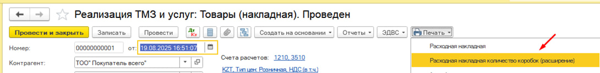
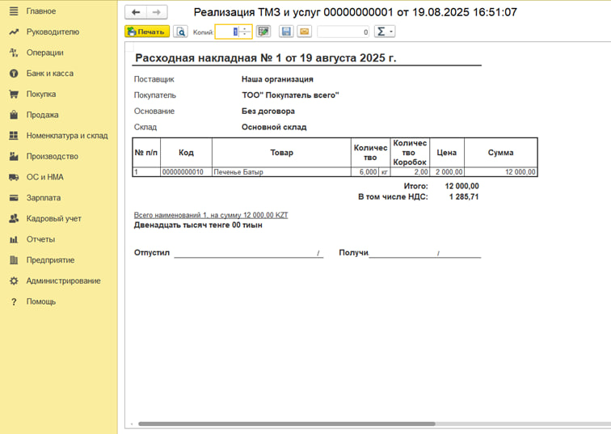
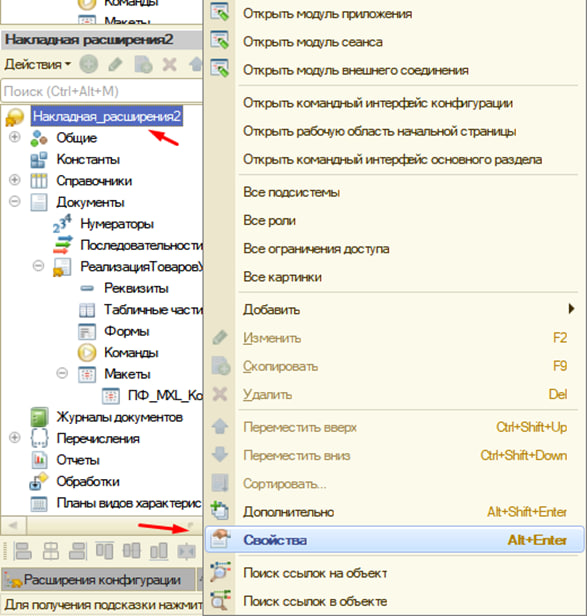

# 1C-Fresh-ПечатнаяФорма-КоличествоКоробок
Расширение для 1С:Fresh. Разработка новой печатной формы с отображением количества коробок без изменения типовой конфигурации.

## О проекте

Данный проект представляет собой расширение для 1С:Fresh, разработанное без изменения типовой конфигурации.

Цель доработки — отображение количества коробок в печатной форме накладной. В информационной базе количество товара хранится в килограммах, однако заказчику требовалось видеть количество коробок в накладных.

---

## Постановка задачи

Необходимо реализовать вывод количества коробок в новой печатной форме накладной, при этом:

- не изменять типовую конфигурацию;
- использовать только механизм расширений;
- обеспечить совместимость с 1С:Fresh.

---

## Реализованное решение

В рамках проекта было выполнено:

- создано расширение конфигурации;
- добавлен реквизит ВесКоробки в справочник Номенклатура через расширение;
- создана новая печатная форма на основе существующего макета;
- реализован расчет количества коробок по формуле;
- обеспечена работа без изменения типовой конфигурации;
- расширение успешно прошло аудит 1С:Fresh и было опубликовано для использования заказчиком.

---

## Используемые технологии

- 1С:Предприятие 8.3
- Расширения конфигурации
- 1С:Fresh
- Макеты печатных форм
- Справочник «Номенклатура»

---

## Результат

В результате внедрения расширения пользователи получили новую печатную форму накладной с отображением количества коробок. Количество коробок рассчитывается автоматически на основании количества товара и значения реквизита «ВесКоробки».

---

## Структура проекта
docs/
screenshots/
src/
README.md

---

## Скриншоты

###Кнопка новой печатной формы

###НоваяПечатнаяФорма

###Расширение

---

## Ключевые навыки

- Разработка расширений 1С
- Доработка печатных форм
- Работа с макетами
- Добавление реквизитов через расширения
- Прохождение аудита 1С:Fresh
